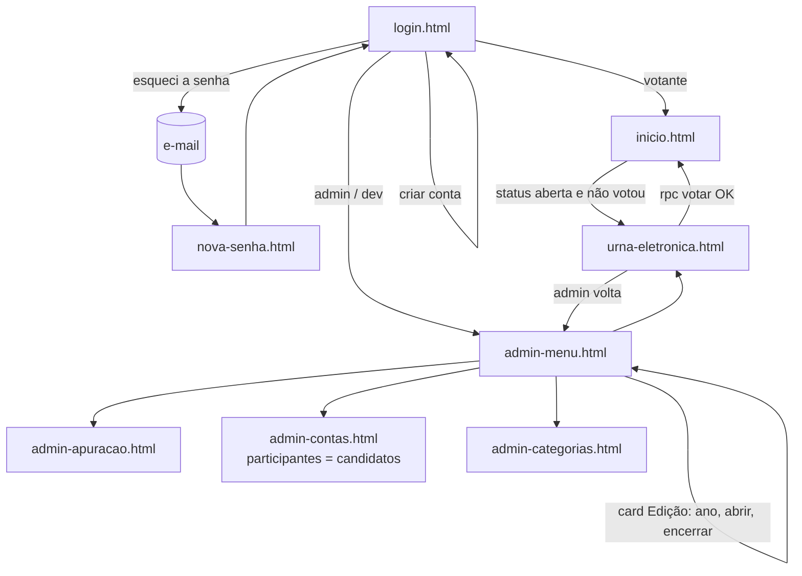
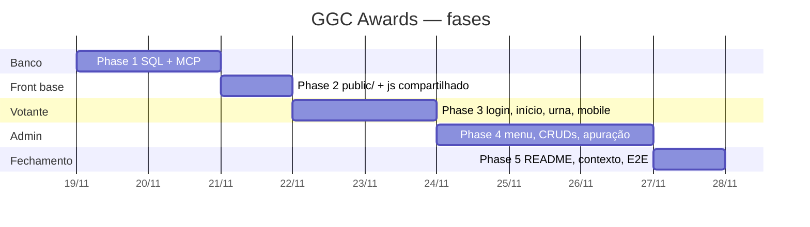

# Implementation Plan: GGC Awards — site de votação com Supabase

**Context:** O grupo GGC vota todo ano em várias categorias (com o grande prêmio GGC Of The Year) e sempre usou Google Forms. Os designs prontos em `temp/` (HTML/CSS/JS puro com dados mock) viram um site real: login com lista de e-mails autorizados, roles, urna estilo brasileira com voto único e secreto, CRUDs de admin e apuração ao vivo com histórico por ano. **Revisão 2026-11-19:** participantes = candidatos (uma tabela só, `contas`); ninguém vota em si mesmo.
**Tech Stack:** HTML + CSS + JavaScript puro (sem framework, sem build), `@supabase/supabase-js@2` via CDN, Supabase (Auth, Postgres + RLS + RPC, Storage, Realtime), aplicado via Supabase MCP (projeto `cftzrevmsucsvkgnqpct`). Hospedagem estática (Vercel ou DigitalOcean App Platform, a decidir no deploy).

---

## 0. Context to Load

> Read EVERY item below BEFORE starting execution. Read the CURRENT version on disk.

**Context docs (conventions and rules):**
- [ ] `context/metaspec.md` — estado atual (projeto vazio, stack não escolhida)
- [ ] `context/CONTEXT_SPEC.md` — regras para atualizar metaspec/index/timeline na Phase 5
- [ ] `temp/menu-admin/README.md` — README mais completo: descreve TODAS as telas e integrações previstas. **Atenção:** ele trata candidatos e contas como tabelas separadas; este plano substitui isso (seção 2).

**Reference code (patterns to follow):**
- [ ] `temp/login/login.html` — visual "vidro fosco + fundo azul" (base do cadastro e de `nova-senha.html`)
- [ ] `temp/crud-candidatos/admin-candidatos.html` — modal Novo/Editar (número em 2 quadradinhos, foto por câmera/galeria, prévia na urna, validação); é reaproveitado DENTRO de `admin-contas.html` e é base da nova `admin-categorias.html`
- [ ] `temp/crud-contas/admin-contas.html` — lista, filtros, switch de papel com Desfazer, travas (`travaDe`), SQL dos gatilhos de convite no comentário do topo
- [ ] `temp/apuracao/admin-apuracao.html` — SQL da view `apuracao` e da `qtd_que_votaram()`; função `apurar()`

**Files to modify (read the current state before altering):**
- [ ] `temp/login/login.html` → vira `public/login.html` (3.1)
- [ ] `temp/landing-votante/inicio.html` → `public/inicio.html` (3.3)
- [ ] `temp/urna-eletronica/urna-eletronica.html` → `public/urna-eletronica.html` (3.4)
- [ ] `temp/menu-admin/admin-menu.html` → `public/admin-menu.html` (4.1)
- [ ] `temp/crud-contas/admin-contas.html` + `temp/crud-candidatos/admin-candidatos.html` → `public/admin-contas.html` (4.2)
- [ ] `temp/apuracao/admin-apuracao.html` → `public/admin-apuracao.html` (4.4)
- [ ] `context/metaspec.md`, `context/index.md`, `context/timeline.md` (5.2)

---

## 1. Goals & Scope

### 1.1. Goals

* **Goals:**
  - Ligar as telas de `temp/` ao Supabase, trocando cada objeto `api`/mock por chamadas reais.
  - Uma única tabela de participantes (`contas`): cada conta é votante E candidato.
  - Garantir no **banco** (RLS + funções), não só na tela: cadastro só de e-mails convidados, voto único, voto secreto, ninguém vota em si mesmo, permissões por role.
  - Fluxo navegável completo: login → (votante) início → urna → início; login → (admin/dev) menu → CRUDs, apuração, urna.
  - Funcionar bem no celular, principalmente login, início e urna.
  - Histórico: cada ano encerrado vira uma apuração congelada, consultável depois.

### 1.2. Scope

* **Inputs:** credenciais (e-mail/senha), cadastro (e-mail, senha), votos da urna (número de 2 dígitos ou branco por categoria), dados dos CRUDs (participante: e-mail, nome, apelido, número, foto, role; categorias), ações do admin (definir ano, abrir/encerrar votação).
* **Outputs:** sessão autenticada com redirecionamento por role; votos anônimos gravados atomicamente; apuração ao vivo do ano corrente; snapshot por ano em `apuracoes`; fotos no bucket `fotos`.
* **In-Scope:** SQL completo (schema, RLS, funções, storage, hook de cadastro, seed) aplicado via MCP; pasta `public/` com as telas integradas; módulo JS compartilhado de auth/guarda; `admin-contas.html` unificada (participantes = candidatos); tela nova `admin-categorias.html`; tela `nova-senha.html`; card de edição (ano + abrir/encerrar) no menu admin; seletor de ano na apuração; ajustes mobile; README de setup.
* **In-Scope (via Supabase MCP):** `apply_migration` dos SQL, `execute_sql` para seed/checks, `get_project_url` + `get_publishable_keys` para `config.js`, `get_advisors` (security) ao fim da Phase 1.
* **Out-of-Scope:** Não criar `public/admin-candidatos.html` nem tabela `candidatos`; o design de `temp/crud-candidatos/` só é fonte do modal.
* **Out-of-Scope:** Não migrar para React/Vite nem introduzir bundler ou `package.json` de build.
* **Out-of-Scope:** Não fazer o deploy nem criar conta na Vercel/DigitalOcean; apenas documentar no README.
* **Out-of-Scope:** Não alterar configurações de Auth do dashboard (Confirm email, hook Before User Created, Redirect URLs); listar os passos para o usuário, salvo se o MCP expuser ferramenta para isso.
* **Out-of-Scope:** Não usar o MCP em nenhum projeto além de `cftzrevmsucsvkgnqpct`.
* **Out-of-Scope:** Não apagar nem editar a pasta `temp/` (referência de design).
* **Out-of-Scope:** Não redesenhar as telas; mudanças visuais só onde o plano pede.
* **Constraint:** `contas`, `categorias` são tabelas únicas (sem ano); só `comparecimento`, `votos`, `edicoes`, `apuracoes` carregam `ano`.
* **Constraint:** Todo participante com `numero` preenchido é candidato em todas as categorias, inclusive admin/dev e convites ainda não cadastrados; sem número = não aparece na urna.
* **Constraint:** Um eleitor nunca pode registrar voto nominal em si mesmo: o próprio nome não aparece na lista da urna, digitar o próprio número mostra "NÚMERO ERRADO / VOTO NULO", e `votar()` grava como `nulo` mesmo se o front for burlado.
* **Constraint:** Nenhuma tabela pode permitir ligar um voto a um eleitor: `votos` não tem eleitor, nem timestamp, e usa `id` uuid aleatório.
* **Constraint:** Toda regra de permissão vale no banco (RLS / `security definer` checando role); esconder botão é só UX.
* **Constraint:** `dev` tem tudo que `admin` tem; nenhum admin pode rebaixar, remover ou criar um `dev` (só via SQL).
* **Constraint:** A anon/publishable key é a única credencial no front; service role key nunca aparece em arquivo do repositório.
* **Constraint:** Visual de cada tela permanece igual ao design de `temp/` em desktop (mesmos tokens CSS do `:root`, fontes e componentes).
* **Constraint:** O e-mail do dev não pode ser escrito em nenhum arquivo commitado; o seed usa placeholder e o e-mail real entra só via `execute_sql`.

---

## 2. Technical Design

### Data Flow
1. **Cadastro do participante (admin/dev):** em `admin-contas.html`, "Novo participante" abre o modal: e-mail, nome, apelido, número (2 quadradinhos), foto, role. Linha fica "Aguardando cadastro" (`user_id` nulo) mas já é candidata se tiver número.
2. **Criar conta (pessoa):** "Primeiro acesso? Criar conta" no login pede só e-mail + senha + confirmar senha (nome/apelido já vieram do admin). Hook *Before User Created* recusa e-mail fora de `contas` ("Esse e-mail não está na lista"). Trigger *after insert* em `auth.users` grava `user_id` na linha. Confirmação de e-mail desligada → signUp já devolve sessão.
3. **Login:** `signInWithPassword` → role em `contas` (`user_id = auth.uid()`) → votante: `inicio.html`; admin/dev: `admin-menu.html`.
4. **Guarda de página:** cada página chama `exigirSessao({ roles })` de `js/auth.js` antes de renderizar.
5. **Início:** lê `eleicao` (ano, status) e `ja_votei()`; Realtime em `eleicao` libera o botão quando o admin abrir.
6. **Urna:** carrega `rpc('candidatos_urna')` (participantes com número, **exceto o próprio**, só campos públicos) e `categorias` (principal por último). Cada CONFIRMA guarda o voto em memória. No FIM, `rpc('votar', { p_votos })` grava tudo atomicamente. Erro → "Tentar de novo". Sucesso → FIM/VOTOU + "Voltar ao início".
7. **`votar()` (security definer):** checa conta ativa, `status='aberta'`, uma entrada por categoria existente; insere `comparecimento(ano, user_id)` (PK impede segundo voto); resolve número → `conta_id` no servidor; número inexistente **ou do próprio eleitor** → `nulo`. Uma transação.
8. **Apuração ao vivo:** view `apuracao` (ano corrente, agrupada por categoria, conta, tipo) + `qtd_que_votaram()`; recarga por Realtime em `comparecimento` + intervalo de 15 s.
9. **Encerrar:** `encerrar_votacao()` → status `encerrada` e congela resultado em `edicoes` + `apuracoes` (número, nome, apelido, título da categoria e foto copiados).
10. **Novo ano:** `definir_ano(n)` (status ≠ aberta e `n` ainda não encerrado) muda `eleicao.ano` e volta para `fechada`.

### Data Structures (Draft)

```text
contas        id uuid PK default gen_random_uuid()
              | email text unique, check (email = lower(email))
              | nome text not null | apelido text | numero text unique null, check '^\d{2}$'
              | foto_url text | role ('votante'|'admin'|'dev')
              | user_id uuid unique → auth.users (on delete set null) | criado_em
categorias    id uuid PK | ordem int | titulo | descricao | principal bool default false
              (índice único parcial: só uma linha com principal = true)
eleicao       id int PK check (id = 1) | ano int | status ('fechada'|'aberta'|'encerrada') | atualizado_em
comparecimento ano int | user_id uuid | PK (ano, user_id)          -- QUEM votou
votos         id uuid PK default gen_random_uuid() | ano | categoria_id → categorias (on delete set null)
              | conta_id → contas (on delete set null; nulo p/ branco/nulo)
              | tipo ('nominal'|'branco'|'nulo')                     -- O QUE foi votado, sem eleitor e sem timestamp
edicoes       ano int PK | eleitores int | votaram int | encerrada_em
apuracoes     ano → edicoes | categoria_ordem | categoria_titulo | principal
              | tipo | numero | nome | apelido | foto_url | votos int
```

```text
Helpers / RPC (security definer, search_path fixo, revoke de anon):
  minha_conta() -> contas.id     do auth.uid()
  minha_role() -> text           role do auth.uid()
  e_admin() -> bool              minha_role() in ('admin','dev')
  candidatos_urna() -> setof (id, numero, nome, apelido, foto_url)
                                 contas com numero, exceto a do auth.uid() (votante não lê e-mails/roles alheios)
  ja_votei() -> bool             comparecimento(ano corrente, auth.uid())
  votar(p_votos jsonb) -> void   [{categoria_id, numero|null, branco bool}]  (Data Flow 7)
  qtd_que_votaram() -> int       e_admin()
  abrir_votacao() / encerrar_votacao() / definir_ano(int)   e_admin()
  remover_conta(id uuid) -> void e_admin(); apaga a linha e, se user_id, apaga auth.users
View apuracao (security_invoker): ano corrente, group by categoria_id, conta_id, tipo
Hook Before User Created: hook_so_convidados(event jsonb) -> jsonb
  (fallback se o hook não puder ser ligado: trigger before insert em auth.users do README de temp/)
```

```text
RLS (resumo):
  contas        select: própria linha OU e_admin(); insert/update/delete: e_admin()
                + trigger proteger_contas: bloqueia mexer em role 'dev', criar 'dev', mudar a
                  própria role, remover/rebaixar o último admin; com status 'aberta' bloqueia
                  mudar numero e remover participante (nome/apelido/foto continuam editáveis)
  categorias    select: autenticado; escrita: e_admin(); trigger bloqueia escrita com status 'aberta'
  eleicao       select: autenticado; escrita só via RPC
  comparecimento select: própria linha OU e_admin(); escrita só via votar()
  votos         select: e_admin(); escrita só via votar()
  edicoes/apuracoes select: e_admin(); escrita só via encerrar_votacao()
  storage fotos  leitura pública; insert/update/delete: e_admin(); 5 MB; image/*
Realtime publication: eleicao, comparecimento
```

```text
public/js/auth.js (pseudocódigo)
  sessaoAtual()            -> { user, conta: {id, nome, apelido, numero, role} } | null
  destinoPorRole(role)     -> 'inicio.html' | 'admin-menu.html'
  exigirSessao({ roles })  -> sem sessão: login; role fora de roles: destinoPorRole
  sair()                   -> signOut + login
```

### File Impact

```text
GGC-awards/
├── public/                              (raiz publicada na hospedagem)
│   ├── index.html                       [ADD] redireciona conforme sessão
│   ├── login.html                       [ADD] de temp/login + criar conta + login por role
│   ├── nova-senha.html                  [ADD] redefinir senha (link do e-mail)
│   ├── inicio.html                      [ADD] de temp/landing-votante
│   ├── urna-eletronica.html             [ADD] de temp/urna-eletronica + RPC + sem auto-voto + mobile
│   ├── admin-menu.html                  [ADD] de temp/menu-admin: card Participantes, Categorias, Edição
│   ├── admin-contas.html                [ADD] temp/crud-contas + modal de temp/crud-candidatos
│   ├── admin-categorias.html            [ADD] nova, no padrão de admin-candidatos
│   ├── admin-apuracao.html              [ADD] de temp/apuracao + realtime + seletor de ano
│   ├── assets/logo_ggc.jpg              [ADD] cópia de temp/utils (favicon/marca)
│   └── js/
│       ├── config.js                    [ADD] URL + publishable key reais (via MCP)
│       ├── supabase.js                  [ADD] cria o client uma vez (window.sb)
│       └── auth.js                      [ADD] sessão, guarda por role, sair
├── supabase/
│   ├── 01_schema.sql                    [ADD]
│   ├── 02_functions.sql                 [ADD]
│   ├── 03_rls.sql                       [ADD]
│   ├── 04_seed.sql                      [ADD] eleicao(id=1), dev com placeholder, categorias exemplo
│   └── 99_checks.sql                    [ADD]
├── README.md                            [ADD]
└── context/{metaspec,index,timeline}.md [MODIFY]
```



---

## 3. Phased Execution



### Phase 1: Banco de dados no Supabase (Infrastructure)
- [ ] **1.1: Schema** [ADD: ./supabase/01_schema.sql]
    - Tabelas da seção 2 com checks; `contas.numero` nullable e único; índice único parcial em `categorias.principal`.
    - `votos` sem eleitor, sem timestamp, id `gen_random_uuid()`. Script idempotente.
    - *Verification:* roda limpo e roda de novo sem erro.
- [ ] **1.2: Funções, view, triggers e hook** [ADD: ./supabase/02_functions.sql]
    - Helpers e RPCs da seção 2, incluindo `candidatos_urna()` e a regra de auto-voto em `votar()`.
    - Trigger `ligar_conta` (after insert em `auth.users`): grava `user_id` na linha do e-mail.
    - `hook_so_convidados(event jsonb)` para *Auth Hooks → Before User Created* (erro 403 "Esse e-mail não está na lista"), com o trigger alternativo comentado.
    - Triggers `proteger_contas` e `travar_categorias_durante_votacao`.
    - *Verification:* `99_checks.sql` passa.
- [ ] **1.3: RLS, storage e realtime** [ADD: ./supabase/03_rls.sql]
    - RLS em todas as tabelas + policies da seção 2; bucket `fotos` (público, 5 MB, `image/*`) com policies via `e_admin()`; publication do Realtime.
    - *Verification:* como votante (JWT simulado com `set local role authenticated` + `request.jwt.claims`), `select * from votos` volta vazio e `select email from contas` só traz a própria linha.
- [ ] **1.4: Seed** [ADD: ./supabase/04_seed.sql]
    - `eleicao` (id=1, ano=2026, status='fechada'); conta dev `'SEU_EMAIL_AQUI'` (role `dev`, número nulo); 2-3 categorias de exemplo incluindo GGC Of The Year (`principal = true`).
- [ ] **1.5: Checks** [ADD: ./supabase/99_checks.sql]
    - Asserts: RLS ligado em todas as tabelas; `votos` sem colunas de eleitor/timestamp; uma categoria principal; `eleicao` com 1 linha; teste de `votar()` com o próprio número resultando em `nulo` (dentro de transação com rollback).
- [ ] **1.6: Aplicar via MCP** (sem arquivo novo)
    - `apply_migration` 01 → 04 (`ggc_01_schema` …); `execute_sql` trocando o placeholder do dev pelo e-mail do usuário (pedir na conversa se não estiver no contexto do executor); `execute_sql` com `99_checks.sql`; `get_advisors` (security) e corrigir alertas.
    - *Verification:* `list_tables` mostra as 7 tabelas com RLS ligado; advisors sem alertas críticos.

### Phase 2: Base do front (Integration)
- [ ] **2.1: Config e client** [ADD: ./public/js/config.js] [ADD: ./public/js/supabase.js]
    - URL e publishable key via `get_project_url` / `get_publishable_keys`; comentário dizendo que a key é pública por design. CDN do supabase-js com versão exata.
    - *Verification:* páginas abrem sem erros no console.
- [ ] **2.2: Auth compartilhado** [ADD: ./public/js/auth.js]
    - Pseudocódigo da seção 2; `body` oculto até a guarda liberar.
    - *Verification:* sem sessão, `admin-menu.html` redireciona para `login.html`.
- [ ] **2.3: Estrutura e entrada** [ADD: ./public/index.html] [ADD: ./public/assets/logo_ggc.jpg]
    - Copiar as telas de `temp/` usadas para `public/` (achatadas) e incluir os 3 scripts. Favicon com o logo.
    - *Verification:* `npx serve public` abre todas as páginas e os links internos funcionam.

### Phase 3: Fluxo do votante (Integration)
- [ ] **3.1: Login + criar conta + esqueci a senha** [MODIFY: ./public/login.html]
    - Login real com redirect por role (remove "Ir para a urna"). Modo "Primeiro acesso? Criar conta": e-mail, senha, confirmar senha. Mensagens: fora da lista, já cadastrado, senha curta. "Esqueci a senha" com `redirectTo` para `nova-senha.html`. Sessão existente → redirect direto.
    - *Verification:* e-mail não convidado vê "Esse e-mail não está na lista"; convidado cria conta e cai na tela da role.
- [ ] **3.2: Nova senha** [ADD: ./public/nova-senha.html]
    - Visual do login; `updateUser({ password })`; volta para o login.
- [ ] **3.3: Início do votante** [MODIFY: ./public/inicio.html]
    - `api` real (usuário, status, `ja_votei`, resumo com nº de categorias e de candidatos, Realtime, sair). Ano no título. Modo `?estado=` só sem config.
    - *Verification:* admin abre a votação em outra aba → botão libera sozinho.
- [ ] **3.4: Urna** [MODIFY: ./public/urna-eletronica.html]
    - `carregarDados()` usa `candidatos_urna()` + categorias; ao abrir, se `status ≠ aberta` ou `ja_votei()` → volta ao início.
    - Próprio número digitado → tela "NÚMERO ERRADO / VOTO NULO" (sai naturalmente, pois não está na lista).
    - `enviarVotos` → `rpc('votar')` com "enviando…", erro com "Tentar de novo" e FIM/VOTOU; "Próximo eleitor" vira "Voltar ao início". Ano no cabeçalho.
    - Mobile (≤ 720px): urna em largura total, teclas ≥ 48px, lista abaixo da urna com altura limitada; desktop mantém a lista à direita.
    - *Verification:* o próprio nome não aparece na lista; votar 2x é bloqueado pelo banco; iPhone SE/Pixel 7 sem scroll horizontal.

### Phase 4: Painel admin (Integration)
- [ ] **4.1: Menu admin** [MODIFY: ./public/admin-menu.html]
    - Guarda `['admin','dev']`; cards: Apuração, **Participantes** (substitui Candidatos + Contas, com selo "N aguardando" e nº de candidatos), **Categorias**, Urna, **Edição** (ano, selo de status, Abrir / Encerrar / Começar novo ano com confirmação).
    - *Verification:* abrir → início libera; encerrar → `edicoes` + `apuracoes` preenchidas.
- [ ] **4.2: Participantes (contas + candidatos)** [MODIFY: ./public/admin-contas.html]
    - Lista do design de contas, com foto e número em cada linha; busca por nome, apelido, e-mail ou número; filtros Todas / Admins / Votantes / Aguardando / Sem número.
    - "Novo participante" e "Editar" abrem o modal de `admin-candidatos` estendido: e-mail (não editável depois de ativo), nome, apelido, número, foto, role (votante/admin), com prévia de como aparece na urna. Validações: e-mail válido e único, nome obrigatório, número 2 dígitos sem dono.
    - O "Adicionar vários e-mails" em lote é substituído por esse modal (cada pessoa precisa de nome e número).
    - Switch de papel com Desfazer e travas mantidos; dev com selo "Dev", sem switch e sem remover. `remover` → `rpc('remover_conta')`. Foto em `fotos/contas/<id>-<timestamp>.<ext>`, apagando a antiga.
    - Com votação aberta: aviso no topo, número e remoção desabilitados.
    - *Verification:* admin não rebaixa o dev nem pelo console (`sb.from('contas').update`); foto pelo celular aparece na urna.
- [ ] **4.3: Categorias (nova)** [ADD: ./public/admin-categorias.html]
    - Visual de `admin-candidatos`: lista, busca, modal (título, descrição), switch "GGC Of The Year (principal)", reordenar ↑↓, excluir com confirmação; trava com votação aberta.
    - *Verification:* marcar outra principal desmarca a anterior numa operação; a urna mostra a principal por último.
- [ ] **4.4: Apuração** [MODIFY: ./public/admin-apuracao.html]
    - `api.carregar()` real usando `conta_id`; Realtime em `comparecimento` + 15 s de fallback; seletor de ano (corrente = ao vivo; anteriores = `apuracoes` + `edicoes`).
    - *Verification:* voto no celular aparece no PC em segundos; ano encerrado mantém nome/foto mesmo após editar o participante.

### Phase 5: Documentação e verificação final (Cleanup)
- [ ] **5.1: README** [ADD: ./README.md]
    - Setup: SQL na ordem (ou via MCP), ligar hook *Before User Created*, **desligar "Confirm email"**, Site URL e Redirect URLs (`nova-senha.html`), rodar local, publicar `public/` na Vercel ou DigitalOcean App Platform.
- [ ] **5.2: Docs de contexto** [MODIFY: ./context/metaspec.md] [MODIFY: ./context/index.md] [MODIFY: ./context/timeline.md]
    - Seguir `context/CONTEXT_SPEC.md`: stack, arquitetura, DATA, AUTH, regras críticas (voto secreto, sem auto-voto, roles), arquivos críticos.
- [ ] **5.3: Roteiro E2E** (sem arquivo novo; resultado no relatório final)
    - Executar o checklist da seção 4 e listar o que depende de ação do usuário no dashboard.

---

## 4. Test Strategy

- [ ] **Banco (SQL):** `99_checks.sql` + testes das RPCs como votante/admin: votar duas vezes, votar fechada, faltando categoria, votar no próprio número (vira nulo), admin rebaixando dev, remover último admin, trocar número com votação aberta. Todos falham com mensagem clara (ou gravam nulo, no caso do auto-voto).
- [ ] **Integração (front ↔ Supabase):** 3 contas (dev, admin, votante): cadastro bloqueado e liberado, redirect por role, guarda das páginas admin, participante com foto, abrir → votar → apuração ao vivo → encerrar → novo ano → histórico.
- [ ] **Segurança:** no console como votante: `sb.from('votos').select()`, `sb.from('contas').select('email')`, `sb.from('contas').update(...)`, `sb.rpc('encerrar_votacao')`, upload no bucket; todos negados ou sem dados alheios.
- [ ] **Mobile / E2E manual:** DevTools (iPhone SE, Pixel 7) + celular real: login, cadastro, início e urna completa.

---

## 5. Rollback & Risks

- **Risk:** Hook *Before User Created* não ligado → qualquer pessoa cria conta.
    - *Mitigation:* fallback por trigger; conta sem linha em `contas` não tem role e RLS/`votar()` negam tudo.
- **Risk:** Voto secreto vazar por correlação (ordem física das linhas ou apuração ao vivo no momento do voto).
    - *Mitigation:* sem timestamp nem eleitor em `votos`, id aleatório; README registra o limite (superusuário do banco / admin olhando a apuração ao vivo).
- **Risk:** Participante muda de número ou é removido com votação aberta.
    - *Mitigation:* trigger bloqueia; votos guardam `conta_id` (não número); snapshot em `apuracoes` no encerramento.
- **Risk:** Votante descobre e-mails/roles dos outros pelo console.
    - *Mitigation:* RLS em `contas` só mostra a própria linha; a urna usa `candidatos_urna()` que expõe só campos públicos.
- **Risk:** Limite do SMTP padrão do Supabase quebrar o "Esqueci a senha".
    - *Mitigation:* confirmação de e-mail desligada; README sugere SMTP próprio se necessário.
- **Risk:** Urna perde os votos se o celular fechar antes do FIM.
    - *Mitigation:* gravação atômica só no FIM (nada parcial); a pessoa refaz a urna.
- **Rollback:** Front: apagar `public/`, `README.md` e reverter `context/` via git. Banco: projeto ainda sem dados reais; `drop` das tabelas/funções `ggc_*` ou recriar o projeto.
